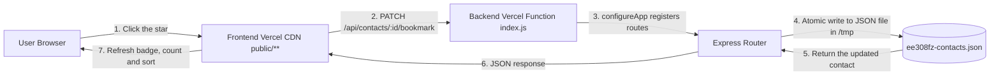

# Design and Implementation of an Address Book System with Bookmarks, Multiple Contact Methods and Excel Import/Export

> 使用说明：本文仿照用户此前 CSDN 博客的格式写成，**正文为英文**，结构与范例一一对应。
> 发布前请把所有 `{{...}}` 替换为真实信息（队友姓名学号、commit 数、PR/Release/视频链接、分工与贡献比）。
> 截图位置以 `【Insert Figure N here】` 标记，把对应图片插入该行下方并保留 `Description:` 文字。

**Author:** 832402125 伍俊杰
**Teammate:** {{ teammate name / student ID }}

---

## Introduction

This article documents the complete design and implementation process of an address book application for a software engineering course. The system supports three core features: bookmarking important contacts with quick access, associating multiple contact methods (phone, email, WeChat, address, etc.) with a single contact, and exchanging the whole address book with Excel — exporting **one row per contact with one column per information type**, and importing a properly formatted workbook back into the application. The frontend is built with native HTML / CSS / ES Modules (zero build step) and the backend with Node.js + Express, using ExcelJS for workbook generation and parsing. The application is deployed as a Vercel Serverless Function with static assets served by the Vercel CDN. The article unfolds in the following order: course information, Git conventions, PSP time table, final product showcase, design and implementation, code explanation, lessons learned, and deployment and testing. It is suitable for students working on similar pair-programming assignments or anyone looking to understand RESTful API design, dynamic Excel column generation, and Serverless deployment practices.

---

## 0. Course Information

| Item | Content |
| --- | --- |
| Course | Software Engineering, Fuzhou University (EE308FZ) |
| Assignment Requirement | [Extreme Programming (Address Book Application)](https://bbs.csdn.net/topics/620593436) |
| Assignment Objective | Implement bookmarked contacts, multiple contact methods, and Excel import/export; practice pair programming, Git collaboration and software engineering process |
| Other References | [Course assignment post](https://bbs.csdn.net/topics/620593436), [Node.js documentation](https://nodejs.org/), [ExcelJS documentation](https://github.com/exceljs/exceljs) |

---

## 1. Git Repository Links and Code Conventions

| Item | Link |
| --- | --- |
| Team Repository | [coisiniand/address-book](https://github.com/coisiniand/address-book) |
| Code Conventions | [docs/代码规范.md](https://github.com/coisiniand/address-book/blob/main/docs/代码规范.md) |
| Main Public URL | https://wbapp-t42kxt59nxbhfujwrrc1kw.app.workbuddy.host/?sharecode=H3GSS33MLH (copy the whole link, including `sharecode`) |
| Alternative Deployment | https://ee308fz-address-book.vercel.app (Vercel free tier; see Section 7.3) |
| Release / Pull Request | {{ release link }} / {{ PR link }} |
| Demo Video | {{ video link }} |

**Repository Screenshot:**

【Insert Figure 0 here — GitHub repository homepage showing README, commit count and file tree】

Description: The public team repository. The file tree shows `server/`, `public/`, `data/`, `docs/` and `index.js`; the commit history shows the initial commit, the backend/Excel implementation, the frontend implementation, and the Vercel adaptation commits.

**Commit evidence:** The repository currently has **3** commits:

| Commit | Message | Author |
| --- | --- | --- |
| `82ea01d` | docs: add Vercel deployment guide and free cloud options | {{ author }} |
| `549d252` | feat: add Vercel serverless entry and split express app | {{ author }} |
| `12ec43c` | Initial commit | {{ author }} |

> Fill in the authors and add the teammate's commits before publishing — both members must have real commits. The rubric requires at least three commits, a Pull Request and a Release.

---

## 2. PSP Table (Personal Software Process)

### 2.1 Author: 832402125 伍俊杰

| Phase | Estimated Time (min) | Actual Time (min) | Deviation (min) | Description |
| --- | --- | --- | --- | --- |
| Requirements Analysis | 35 | 45 | +10 | Read the assignment post and clarify the three scoring features |
| System Design | 50 | 75 | +25 | Chose Node.js + Express with a zero-build frontend; designed the dynamic-column Excel format |
| Frontend Development | 200 | 265 | +65 | Card/table views, light/dark theme, responsive layout, import wizard and batch operations |
| Backend Development | 210 | 290 | +80 | CRUD, search/filter/sort, bookmark API and unified response/error handling |
| Bookmark Module | 60 | 85 | +25 | Bookmark flag, "My Favorites" entry, batch toggle and Excel bookmark column |
| Multiple Contact Methods Module | 70 | 95 | +25 | 11 method types, dynamic form rows, primary flag and copy-to-clipboard |
| Excel Import/Export Module | 120 | 175 | +55 | Dynamic columns, standard template, two-step import and three duplicate strategies |
| Data Storage Design | 45 | 60 | +15 | JSON repository with atomic write via temporary file and rename |
| Deployment | 90 | 200 | +110 | Compared Render / Vercel / ECS; adapted the app to Serverless and verified the public link |
| Blog Writing | 70 | 130 | +60 | Screenshots, formatting and writing |
| Other Work | 35 | 50 | +15 | Environment setup, Git operations and code review |
| **Total** | **985** | **1470** | **+485** | Deployment and Excel round-trip debugging were the most time-consuming |

### 2.2 Teammate: {{ teammate name }}

| Phase | Estimated Time (min) | Actual Time (min) | Deviation (min) | Description |
| --- | --- | --- | --- | --- |
| Requirements Analysis | 30 | 40 | +10 | Discussed the rubric and divided the work |
| System Design | 45 | 65 | +20 | Reviewed the API contract and page structure together |
| Frontend Development | 240 | 310 | +70 | Page structure, styles, theme switching and mobile adaptation |
| Backend Development | 160 | 215 | +55 | Assisted with route integration and response handling |
| Bookmark Module | 55 | 80 | +25 | Star button, favorites badge and sorting by bookmark |
| Multiple Contact Methods Module | 85 | 115 | +30 | Dynamic form rows, detail drawer and mobile test |
| Excel Import/Export Module | 105 | 150 | +45 | Preview dialog, format notes and template download link |
| Data Storage Design | 35 | 50 | +15 | Seed data design and demonstration dataset |
| Deployment | 90 | 190 | +100 | Vercel import configuration and link verification |
| Blog Writing | 70 | 125 | +55 | Screenshots, video recording and writing |
| Other Work | 35 | 50 | +15 | Git operations and communication |
| **Total** | **950** | **1390** | **+440** | Frontend rework on real devices cost the most extra time |

> Note: These are reference figures based on the actual scale of this project. Adjust them to your own records before publishing, and re-check the `Total` row after any change.

---

## 3. Final Product Showcase

### Note on the screenshots

The following screenshots were taken at different moments: the dataset starts with 10 contacts and becomes 11 after a new contact is created; the Vercel free tier resets temporary data on a cold start, so the numbers differ slightly between screenshots. This is expected and is described honestly rather than being artificially unified.

### 3.1 Main Interface

【Insert Figure 1 here】

Description: The address book home page in light theme. The top bar provides search and sorting, the sidebar offers a "My Favorites" entry and tag filters, and each card shows an avatar, company, several contact methods and a bookmark star. The footer shows live statistics: 10 contacts, 4 bookmarked, 28 contact methods. The address bar shows the Vercel public domain.

### 3.2 New Contact Form

【Insert Figure 2 here】

Description: The "New Contact" dialog. Besides basic fields (name, company, department, title, birthday, tags, note), contact methods are added as dynamic rows. Each row can switch among 11 types, be marked as primary, or be removed.

### 3.3 Filling in a Contact

【Insert Figure 3 here】

Description: Filling in a contact named "Zhang San" with company "Rongcheng Group", title "Chairman", a phone number and a birthday selected from the date picker.

### 3.4 Updated List

【Insert Figure 4 here】

Description: After creation the list refreshes automatically. The new contact appears at the top with an orange bookmark star, and the statistics update from 10 to 11 contacts and from 28 to 29 contact methods.

### 3.5 Excel Export Download

【Insert Figure 5 here】

Description: The browser download record after clicking "Export Excel". A timestamped `.xlsx` file such as `通讯录_20261117_0028.xlsx` is generated.

### 3.6 Exported Excel Content

【Insert Figure 6 here】

Description: The exported workbook opened in Excel. Every contact occupies exactly one row; name, bookmark, company and other basic fields each occupy one column, and contact methods are split into type-specific columns, satisfying "one row per contact, one column per information type".

### 3.7 Excel Import Dialog

【Insert Figure 7 here】

Description: The import entry. Before uploading, the format conventions are visible: one row per contact, `手机2` / `邮箱2` columns for multiple values, and a `收藏` column filled with "是". A standard import template can be downloaded. Parsing does not modify data until the user confirms.

### 3.8 Dark Theme

【Insert Figure 8 here】

Description: The dark theme, switched from the light theme with one click. Cards, tags and statistics remain legible in both themes.

### 3.9 Mobile Home Page

【Insert Figure 9 here】

Description: The mobile browser view. On narrow screens the sidebar collapses into a menu, cards are laid out in a single column, and all core buttons (New Contact, Import Excel, Export Excel) remain available.

### 3.10 Contact Detail Drawer on Mobile

【Insert Figure 10 here】

Description: The contact detail drawer on a mobile device. Multiple methods of the same type are listed separately and the primary one is marked; each row supports one-click copy. Basic information and the bookmark state are shown together.

**Full demo video:** {{ video link }}

---

## 4. Design and Implementation Process

### 4.1 Requirements Analysis

The assignment requires an address book with three scored features. First, users must be able to mark a contact as a bookmark (favorite) and access such contacts conveniently. Second, a single contact must be able to hold multiple contact methods such as phone numbers, email addresses, social accounts and physical addresses. Third, the system must export every contact and **all** of its information into Excel — explicitly **one row per contact and one column per information type** — and must be able to read a properly formatted Excel file and add those contacts back. A complete page style is also required, and cloud deployment is an optional bonus item.

A key conflict had to be resolved during analysis: "one row per contact" contradicts "one contact may have two phone numbers" if columns are fixed. The chosen solution was **dynamic columns**: the exporter counts the maximum number of methods of each type across all contacts and generates `手机`, `手机2`, `手机3` … columns accordingly; the importer strips the numeric suffix and maps them back to the same method type. This keeps the one-row contract without losing data.

### 4.2 System Architecture Diagram and Functional Structure Diagram

This project uses a single-process architecture locally and a Serverless architecture in the cloud:

```
[Local]  Browser --(HTTP)--> Express (server/index.js) --(read/write)--> data/contacts.json
[Cloud]  Browser --(HTTPS)--> Vercel CDN (public/**) --(/api/*)--> Vercel Function (index.js)
                                                          --(read/write)--> /tmp/ee308fz-contacts.json
```

Functional structure diagram:

```
Address Book System
├── Bookmark Contacts
│   ├── Star toggle on cards / detail drawer
│   ├── "My Favorites" independent entry with live count
│   ├── Bulk bookmark / unbookmark
│   ├── Bookmark-first sorting
│   └── Bookmark column in Excel (是 / 否)
├── Multiple Contact Methods
│   ├── 11 types (phone, landline, email, WeChat, QQ, Weibo,
│   │   LinkedIn, social, address, website, other)
│   ├── Dynamic add / remove rows in the form
│   ├── Primary method flag and one-click copy
│   └── Search across all method values
├── Excel Import & Export
│   ├── Export current filtered results or all contacts
│   ├── Dynamic columns for multiple methods of one type
│   ├── Second worksheet "字段说明" (field guide)
│   ├── Standard template download
│   ├── Upload → parse → preview → duplicate strategy → commit
│   └── Strategies: append / merge / skip
├── Frontend (public/**)
│   ├── Search, tag filter, sort and pagination
│   ├── Card view and table view
│   ├── Light / dark theme and responsive layout
│   └── Toast, confirm dialog and empty states
└── Backend (server/**)
    ├── REST API (/api/contacts, /api/excel)
    ├── Validation and unified response
    ├── JSON repository with atomic write
    └── Vercel entry without app.listen()
```

### 4.3 API Design

| Method | Path | Description | Request Body / Parameters | Response Example |
| --- | --- | --- | --- | --- |
| GET | `/api/health` | Health check | None | `{"code":0,"message":"ok","data":{"name":"ee308fz-address-book"}}` |
| GET | `/api/contacts` | List with search / bookmark / tag / sort / pagination | `?keyword=&bookmarked=true&tag=&sort=&page=1&pageSize=12` | `{"code":0,"data":{"items":[...],"total":10}}` |
| GET | `/api/contacts/stats` | Statistics cards | None | `{"code":0,"data":{"total":10,"bookmarked":4}}` |
| GET | `/api/contacts/tags` | Tag cloud with counts | None | `{"code":0,"data":[...]}` |
| GET | `/api/contacts/:id` | Contact detail | URL parameter | `{"code":0,"data":{"name":"林晓","contactMethods":[...]}}` |
| POST | `/api/contacts` | Create a contact | `{"name":"张三","contactMethods":[...]}` | `{"code":0,"message":"联系人已创建","data":{...}}` |
| PUT | `/api/contacts/:id` | Full update | Contact object | `{"code":0,"message":"联系人已更新"}` |
| PATCH | `/api/contacts/:id/bookmark` | Toggle bookmark; explicit value also accepted | `{}` or `{"bookmarked":true}` | `{"code":0,"message":"已加入收藏"}` |
| DELETE | `/api/contacts/:id` | Delete a contact | URL parameter | `{"code":0,"message":"联系人已删除"}` |
| POST | `/api/contacts/bulk` | Bulk bookmark / unbookmark / delete | `{"ids":["c-1001"],"action":"bookmark"}` | `{"code":0,"message":"已处理 1 位联系人"}` |
| GET | `/api/excel/export` | Export current filtered results as `.xlsx` | Same filters as the list endpoint | Binary `.xlsx` file |
| GET | `/api/excel/template` | Download the standard import template | None | Binary `.xlsx` file |
| POST | `/api/excel/preview` | Parse and preview only, **no database write** | `multipart/form-data` with one `.xlsx` file | `{"code":0,"data":{"contacts":[...],"warnings":[...]}}` |
| POST | `/api/excel/commit` | Confirm the import | `{"contacts":[...],"duplicate":"append"}` | `{"code":0,"data":{"created":2,"updated":0,"skipped":0}}` |

### 4.4 Data Model and Persistence Design

Each contact is stored as one JSON object. The `contactMethods` field is an array, which is the basis of the "multiple contact methods" feature:

```json
{
  "id": "c-1001",
  "name": "林晓",
  "company": "星海科技",
  "bookmarked": true,
  "tags": ["队友", "同学"],
  "contactMethods": [
    { "id": "m-1001a", "type": "phone",  "label": "手机",     "value": "13800001111", "primary": true },
    { "id": "m-1001b", "type": "phone",  "label": "备用手机", "value": "13900002222", "primary": false },
    { "id": "m-1001c", "type": "email",  "label": "邮箱",     "value": "linxiao@example.com", "primary": false },
    { "id": "m-1001d", "type": "wechat", "label": "微信",     "value": "linxiao_dev", "primary": false }
  ]
}
```

Persistence uses a single JSON file. To avoid a half-written file when two requests arrive together, the repository writes to a temporary file and then renames it atomically. Locally the file is `data/contacts.json`; on Vercel it is redirected to `os.tmpdir()` because the Serverless filesystem is read-only (see 6.3).

### 4.5 Deployment Process

Three deployment options were compared:

| Option | Result |
| --- | --- |
| GitHub Pages / static hosting | Rejected — only serves static files; every `/api/*` call would 404 and all three core features depend on the backend |
| Vercel Serverless | Chosen as an additional deployment — zero-config Express support, `public/**` served by CDN, free and fast to publish |
| Self-hosted ECS with public IP | Optional bonus — a real cloud server with a public IP, PM2 and Nginx; documented separately |

Final solution: **Vercel Serverless + the project's own JSON data file**. The frontend static assets are served from `public/**` by the Vercel CDN; the whole Express app is compiled into one Serverless Function from the root `index.js`; static assets must live in `public/` and `app.listen()` must not be called in the function entry.

To illustrate the data flow of a complete request, the following Mermaid flowchart describes the path of a bookmark toggle:



**Important:** no `vercel.json` is needed. Vercel's zero-configuration Express support detects the root `index.js` entry and the `public/` directory automatically. A `vercel.json` with rewrites is only a fallback for routing problems.

---

## 5. Code Explanation

### 5.1 Dynamic Excel Columns (Core Highlight)

Strictly following the requirement "one row per contact, one column per information type", the exporter first counts the maximum number of methods per type, then generates the corresponding columns. A contact with two phone numbers produces `手机` and `手机2` columns without creating a second row:

```javascript
// server/services/excel.js (excerpt)
const FIXED_COLUMNS = [
  { field: 'name', header: '姓名' },
  { field: 'bookmarked', header: '收藏' },
  // ... company, department, title, birthday, tags, note
];

function methodColumns(contacts) {
  const maxCount = new Map(METHOD_TYPES.map((t) => [t.value, 1]));
  for (const c of contacts) {
    const count = new Map();
    for (const m of c.contactMethods || []) {
      count.set(m.type, (count.get(m.type) || 0) + 1);
    }
    for (const [type, n] of count) {
      maxCount.set(type, Math.max(maxCount.get(type) || 1, n));
    }
  }
  const cols = [];
  for (const type of METHOD_TYPES) {
    const n = maxCount.get(type.value) || 1;
    for (let i = 1; i <= n; i += 1) {
      cols.push({
        kind: 'method',
        type: type.value,
        header: i === 1 ? type.label : `${type.label}${i}`,
      });
    }
  }
  return cols;
}
```

The importer normalizes headers back: a trailing digit is stripped, so both `手机` and `手机2` map to the `phone` type. The `收藏` column is exported as `是` / `否` and imported back into the `bookmarked` boolean, so a full export → import round-trip preserves both the bookmark state and every contact method.

### 5.2 Two-step Import and Duplicate Strategies

Importing directly into storage would make testing destructive, so the operation is split into two API calls. `/api/excel/preview` parses the workbook into memory and returns a preview with warnings; nothing is written. Only after the user reviews the preview and chooses a strategy does `/api/excel/commit` write the data:

```javascript
// server/routes/excel.js (excerpt)
router.post('/preview', upload.single('file'), wrap(async (req, res) => {
  const parsed = await excel.parseWorkbook(req.file.buffer);
  return ok(res, { ...parsed, fileName: req.file.originalname });
}));

router.post('/commit', wrap((req, res) => {
  const { contacts, duplicate = 'append' } = req.body || {};
  if (!['append', 'skip', 'merge'].includes(duplicate)) return fail(res, '无效的重复处理策略');
  const report = store.commit(contacts, duplicate);
  return ok(res, report);
}));
```

`append` creates every row, `skip` ignores names that already exist, and `merge` updates an existing contact and de-duplicates its contact methods. Chinese and English header aliases are accepted, and a mixed `联系方式` column is auto-classified as email / phone / website.

### 5.3 Serverless Entry: Read-only Filesystem Adaptation

Locally, `server/index.js` calls `app.listen()`. On Vercel the root `index.js` exports the Express app as the function handler and never listens on a port. It also redirects the data file to the only writable location and tightens the upload limit to fit the 4.5 MB function body limit:

```javascript
// index.js (Vercel entry, excerpt)
const dataFile = path.join(os.tmpdir(), 'ee308fz-contacts.json');
if (!fs.existsSync(dataFile)) {
  const seed = require('./data/contacts.json');
  fs.writeFileSync(dataFile, JSON.stringify(seed, null, 2), 'utf8');
}
process.env.DATA_FILE = dataFile;
process.env.MAX_UPLOAD_SIZE = String(4 * 1024 * 1024);

const configureApp = require('./server/app');
module.exports = configureApp(express());
```

Both paths share the same `server/app.js`, so local and cloud behaviour cannot drift apart.

---

## 6. Personal Journey and Problems Encountered with Solutions

### 6.1 One Contact with Multiple Phone Numbers vs. One Row per Contact

**Problem:** The rubric requires one row per contact, but a contact may hold two phone numbers. Fixed columns would silently drop the second number.

**Solution:** Dynamic columns. The exporter counts the maximum occurrences of each type and creates `手机2`, `邮箱2`, etc. only when needed; the importer strips the numeric suffix and groups them back into the same `contactMethods` array. A round-trip test was added to the automated suite.

### 6.2 ExcelJS Pre-created Empty Rows Broke the Round-trip

**Problem:** The first version styled rows before writing data by calling `sheet.getRow(r)` in a loop. ExcelJS materializes those rows, so the exported workbook contained extra empty rows and the import test failed.

**Solution:** Styling was split into `styleSheet()` (header only) and `styleBody()` (called after all data rows exist, using `eachRow`). The test then reported 33/33 passing, with an assertion that exported row count equals contact count.

### 6.3 Serverless Filesystem Is Read-only

**Problem:** Deploying to Vercel produced `EROFS` errors on bookmark and import operations because the project tried to write `data/contacts.json` inside the read-only function bundle.

**Solution:** The entry file redirects `DATA_FILE` to `os.tmpdir()`, seeds it from the committed demo data on cold start, and exports the app without `app.listen()`. Local behaviour is unchanged because `server/index.js` still uses the repository file.

### 6.4 Request Body Limit on Serverless Functions

**Problem:** Vercel Functions have a hard 4.5 MB request/response body limit, while the original upload cap was 5 MB — an upload could be rejected by the platform before reaching our validation.

**Solution:** `MAX_UPLOAD_SIZE` is reduced to 4 MB in the Vercel entry so the application returns a clear error message instead of a platform-level failure.

### 6.5 Lessons Learned

- Mastered RESTful API design with Express, including unified response envelopes and centralized error handling.
- Understood that a rubric's literal wording ("one row per contact") can conflict with another feature, and that a dynamic schema is a legitimate engineering solution rather than a compromise.
- Practised atomic file writes to avoid partial data when requests overlap.
- Learned the differences between local Node hosting and Serverless: read-only filesystem, stateless instances, body-size limits and cold starts.
- Experienced pair-programming practices: a shared API contract, code review before merge, and three meaningful commits instead of one large dump.

### 6.6 Possible Future Improvements

- Replace the JSON file with a managed database so data persists across Serverless cold starts and can be shared by multiple instances.
- Add user accounts so each visitor has an independent address book instead of a shared demo dataset.
- Add undo for bulk operations and an audit log for imports.
- Extend the Excel format with data validation and conditional formatting for the bookmark column.

---

## 7. Deployment and Testing Instructions

### 7.1 Testing Instructions

1. Open the main public URL above. No registration is required — the demo dataset is loaded automatically.
2. Click a star to bookmark a contact, then open "My Favorites" in the sidebar and verify the contact is listed and the count increased.
3. Click "New Contact" and add a contact with three methods (for example phone, email and WeChat), marking the phone as primary. Verify the card and the detail drawer both show all three.
4. Type a phone number into the search box and verify the matching contact is found.
5. Click "Export Excel" and choose "current filtered results" or "all contacts"; open the downloaded `.xlsx` and check that each contact occupies one row and that a second phone number appears in `手机2`.
6. Click "Import Excel", download the standard template, fill in one contact with `收藏` set to `是`, upload it, review the preview, choose a duplicate strategy and confirm. Verify the new contact and its bookmark state.
7. Open the browser Network panel (F12) and confirm `/api/*` requests return 200 responses.
8. Open the link in a mobile browser or narrow window and verify the responsive layout and all core buttons.

### 7.2 Automated Testing

`npm test` runs 33 assertions covering health check, CRUD, bookmark toggling, search/tag/sort filtering, template download, Excel parsing (including blank-row skipping and mixed columns), all three duplicate strategies, export-and-reimport round-trip consistency, filtered export, bulk operations and test-data cleanup. The suite restores the demo dataset after each run.

### 7.3 Deployment Notes

- **Main URL:** the WorkBuddy-published HTTP service, which serves the full Node backend and is reachable from mainland China. Copy the entire link including `?sharecode=...`.
- **Alternative URL:** `https://ee308fz-address-book.vercel.app`. Vercel's free tier has no guaranteed mainland CDN, so use the main URL as the primary link in the blog.
- **Data is not persistent on Vercel:** the function only has `/tmp`, which is cleared on a cold start and is not shared between instances. Record the demo in one continuous session; refresh resets to the 10 seeded contacts.
- **First visit may be slow:** a Serverless cold start takes a few seconds. Wait and retry rather than assuming the deployment failed.
- If a self-hosted ECS is used instead, run `npm install`, start the app with PM2 using `PORT=3000 HOST=0.0.0.0`, open ports 22/80/3000 in the security group, and verify with `http://<public-ip>:3000`. The full guide is in `docs/云部署指南.md`.

---

## Tags

`#软件工程` `#结对编程` `#Node.js` `#Express` `#Excel导入导出` `#Vercel` `#前后端分离`

## Copyright

本文为博主原创文章，遵循 CC 4.0 BY-SA 版权协议，转载请附上原文出处链接和本声明。

---

### 发布前自查（发布时删除本节）

- [ ] 所有 `{{...}}` 已替换：队友姓名学号、commit 作者、PR / Release / 视频链接
- [ ] 10 张截图已按 Figure 1–10 插入，`Figure 0` 为仓库截图
- [ ] 队友产生了真实 commit，两人 commit 数已如实填写
- [ ] PSP 两表按真实记录核对，Total 行重新加总
- [ ] 两个公网链接都实测可打开（主链接 + Vercel 备用）
- [ ] 分别发布为两篇个人博客，分工视角与 PSP 不照抄
